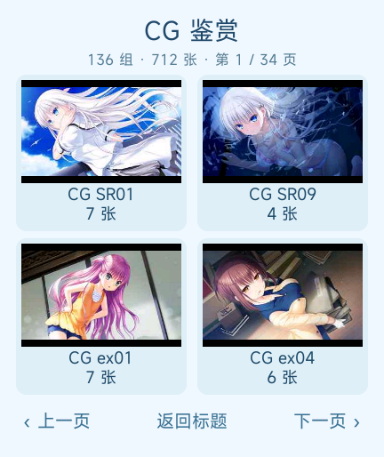
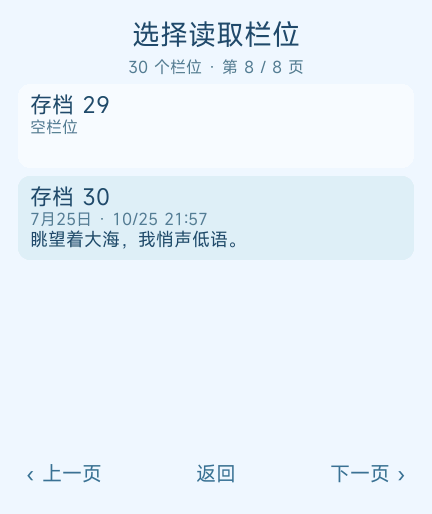
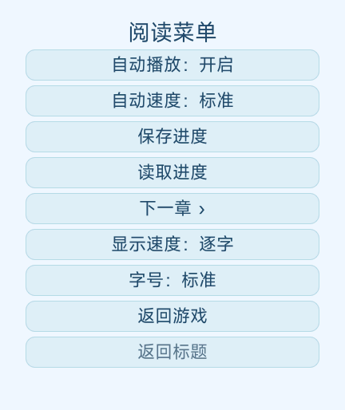
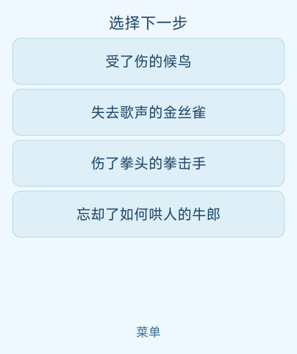

# 夏日口袋 · REDMI Watch 5

基于《Summer Pockets REFLECTION BLUE》Windows 版资源制作的 Xiaomi Vela 视觉小说阅读应用，适配 **REDMI Watch 5（432 × 514）**。当前版本为 **0.3.0 / versionCode 15**；小米手环 8 Pro 尚未适配。

程序实现、资源转换、界面适配、测试工具与文档由 **OpenAI Codex** 在维护者的需求与反馈指导下完成。维护者负责提供资源、审查成果及实机测试。自编代码采用 MIT，原作与第三方素材按各自授权处理。

## 下载与安装反馈

[下载 v0.3.0](https://github.com/xuanyide01/summer-rw5/releases/tag/v0.3.0) · [BIN 安装包](https://github.com/xuanyide01/summer-rw5/releases/download/v0.3.0/summer-rw5-v0.3.0.bin) · [RPK 安装包](https://github.com/xuanyide01/summer-rw5/releases/download/v0.3.0/summer-rw5-v0.3.0.rpk) · [完整更新说明](docs/v0.3.0.md)

> **实机安装反馈（2026-10-27）：** 维护者首次安装后无法显示应用图标，重启后仍未安装成功；重置手表后安装成功，随后暂未发现游戏内 bug。首次安装问题的原因尚未确认。重置只是这次实测经过，**不是推荐安装步骤**。详见 [实机反馈记录](reports/hardware-test-v030.json)。

| 项目 | 内容 |
| --- | --- |
| 应用名称 | 夏日口袋 |
| 包名 | `com.codex.summer.rw5` |
| 当前版本 | 0.3.0 / versionCode 15 |
| BIN / RPK 大小 | **24,983,777 字节，约 24.984 MB** |
| 安装包上限 | 25,000,000 字节；安装后占用和运行内存另计 |

BIN 与 RPK 内容相同，任选安装工具支持的格式；当前产物使用开发签名。两种文件的 SHA256 均为：

```text
964e1db4693560fa5fefdb5a1a162bb8f344fd7d0003edd05d58249eba325916
```

## 画面预览

以下截图均来自**已安装 0.3.0 的官方 Vela 原生模拟器**，尺寸为 432 × 514；不是实机拍照。标题、阅读、菜单、存档和 CG 界面统一展示当前版本。

| 标题界面 | 共通剧情：仅日期 | 个人线：人物名与表情 |
| --- | --- | --- |
|  |  |  |

| CG 列表 | CG 差分鉴赏 | 30 栏读档 |
| --- | --- | --- |
|  |  |  |

| 阅读菜单与自动播放 | 剧情选项 |
| --- | --- |
|  |  |

[查看 40 个新增表情的导出资源对比](docs/images/expressions-v030.jpg)。旧版截图与验证记录见 [历史文档](docs/history-validation.md)。

## 内容与功能

- **五条个人线与最终篇**：保留鸣濑白羽、空门苍、紬文德斯、久岛鸥、神山识的个人线，以及 **ALKA、Pocket 和尾声**。美希、静久、羽未的个人线移除，她们在共通线中的事件保留。
- **剧情规模**：81,040 条对白/旁白、188 处对白选择、252 个可选章节入口。OPTIONS 中可进入路线/章节阅览。
- **原作标题风格**：原作标题场景、白羽形象与透明按键；Logo 顶部居中，按键左侧竖排。精简版在完成第 4、第 5 条个人线后触发对应 ReSTART 阶段，五条完成后解锁 ALKA，ALKA 完成后解锁 Pocket。
- **完整立绘与新增表情**：267 个姿势映射，对重复图片去重后为 252 份底图；新增 40 份完整表情图，五位女主各 8 个。眼睛、嘴巴补丁先合回原画布，再输出完整 RGBA 立绘，尺寸上限保持 200 × 256。
- **点击与自动阅读**：上方画面和正文都可点击推进；逐字显示未完成时先补全当前句，再次点击才推进。菜单提供慢速、标准、快速三档自动播放；遇到选项暂停，玩家选择后继续。拖动、菜单、存档页和后台会暂停自动推进。
- **30 个存档栏位**：自行选择保存和加载栏位，覆盖前确认；保留原有存档键和格式。
- **安全下一章**：从菜单快进到下一章或首个待选选项；选项必须手动选择，不会自动越过分支。
- **分组 CG 鉴赏**：本版收录 712 张 CG，按场景分为 136 组，当前收录全部开放；打开后点击图片切换同场景差分。章节直达与 CG 鉴赏可能提前展示后续剧情。
- **日期与姓名**：共通剧情只显示日期，进入个人线后仅显示人物名；人物标签使用“紬文德斯”，对白保留原作简称“紬”。
- **目录曲**：标题、OPTIONS、MANUAL、LOAD、CG 列表和单张 CG 鉴赏连续播放，不因页面切换从头起播；进入剧情、后台或退出时停止，可在 OPTIONS 关闭。
- **包体与加载**：保持 25 MB 上限；剧情按 1,024 条指令分块。图片、PCM 音频、字体使用 STORE，减少安装时的 DEFLATE 解压工作；保留图片没有进一步降低画质。

## 安装与使用

1. 使用支持 REDMI Watch 5 的 Vela 应用安装工具，已有实测使用“表盘自定义工具”（[米坛社区 BandBBS](https://www.bandbbs.cn/)）。
2. **工具提示安装完成后，仍需等待手表端真正安装结束。** 等应用与图标正常显示后再打开，不要刚看到完成提示就反复重装。当前版本的首次安装问题见上方实机反馈。
3. 在标题选择 START、LOAD 或 GALLERY。路线/章节阅览位于 OPTIONS 中。
4. 阅读时点击上方画面、正文或“下一句”推进；从菜单保存、加载、跳至下一章或开启自动播放。选项需手动选择。
5. CG 列表每个场景只占一项，打开后点击图片切换差分。

**旧档兼容性：** 保留场景中的旧档继续可读；被移除个人线中的旧档不能在 0.3.0 继续，请保留 [0.2.5](https://github.com/xuanyide01/summer-rw5/releases/tag/v0.2.5) 用于读取这些存档。更新前保留旧包和存档，卸载可能清除存档；不同安装工具的覆盖更新行为尚不能一概而论。

## 验证与已知限制

0.3.0 的 **52 项自动检查通过**，覆盖剧情分块、保留章节、旧存档、CG、自动阅读、音频清理及本次改动；从五条个人线通关状态可完整遍历 ALKA/Pocket，无需补记被移除角色的结局。

最终完整 RPK 在独立官方 Vela 模拟器全新安装成功，读回版本为 0.3.0 / 15，编译页面与发布包一致。上方画面推进、日期/姓名、代表表情、旧第 30 栏存档和返回标题音乐检查通过。模拟器覆盖安装曾返回 `-19`，原因未确认，未将它与实机图标问题认定为同一原因。详情见 [本版验证说明](docs/v0.3.0.md)、[原生记录](reports/native-v030.json) 和 [历史验证](docs/history-validation.md)。

- 官方 `vela-watch-5.0` 镜像并非 REDMI Watch 5 固件的完整复刻；实机结果以上方维护者反馈为准。
- 本项目是手表端视觉小说阅读应用，Windows 原版引擎没有在手表上运行。
- 剧情中不含原版 BGM、配音、视频、复杂动画或完整多人站位。目录曲为完整 237 秒、PCM 16 位 / 4 kHz 单声道，为满足包体限制减少了高频细节。
- 40 个新增表情覆盖常用姿势，其他姿势仍共用底图，未还原全部表情。小游戏玩法未复现，可阅读相关对白。
- 地图图标状态和部分原引擎接口尚未完整复现；章节直达不代表原版全部解锁流程均已还原。

## 开发与构建

仓库包含已转换的运行资源，常规构建无需读取 Windows 游戏目录。也可从 Release 下载 [源码 ZIP](https://github.com/xuanyide01/summer-rw5/releases/download/v0.3.0/summer-rw5-v0.3.0-source.zip) 与 [资源 ZIP](https://github.com/xuanyide01/summer-rw5/releases/download/v0.3.0/summer-rw5-v0.3.0-resources.zip)，将两者解压到同一目录，合并为 `summer-rw5/`。Release 中的 ZIP 是发布时快照，GitHub 主分支包含后续文档和截图更新。

准备 Node.js 与 npm，在项目根目录执行：

```powershell
npm ci
npm install --prefix tools/compat-toolkit --ignore-scripts
npm test
npm run release
```

产物为 `dist/com.codex.summer.rw5.debug.0.3.0.rpk`。构建使用 **aiot-toolkit 1.1.0** 兼容编译器，项目根目录的 2.0.5 依赖用于开发和模拟器工具。发布构建保留图片字节、调整 ZIP 封装并重新签名，检查 25,000,000 字节上限。重建包含新的时间信息，不保证与发布附件具有相同 SHA256。

```text
src/                  Vela 应用与转换后的运行资源
converted-story/      转换流程校验数据
tools/                格式解析、资源处理、构建和模拟器工具
tests/                自动检查
reports/              本版及历史验证、实机反馈
licenses/             第三方许可证
docs/                 更新说明、历史记录和版本截图
```

原版资源分析工具需将 `SUMMER_GAME_ROOT` 设为 `SummerPocketsRB.exe` 所在目录；它们针对本次资源格式，不是任意 Galgame 的一键转换工具。姓名字体子集已随资源提供，变更相关文本后才需重建并检查覆盖范围。

### 原生模拟器

下面显式指定与 `emulator:setup` 一致的设备名，并统一控制端口。首次准备会下载官方 SDK；运行前确认同名设备与这些端口未被其他实例占用。

```powershell
$env:STARRY_EMULATOR_HOME = Join-Path $env:LOCALAPPDATA 'SummerRW5Dev'
$env:WATCH_SDK_HOME = Join-Path $env:STARRY_EMULATOR_HOME 'sdk'
$env:WATCH_VVD_NAME = 'RedmiWatch5-432x514'
$env:WATCH_SERIAL_PORT = '5556'
$env:WATCH_GRPC_PORT = '8556'
$env:WATCH_DEBUG_PORT = '10056'
$env:WATCH_HTTP_PORT = '43126'
npm run emulator:setup
npm run emulator
```

虚拟系统启动完成后，在同项目的另一个 PowerShell 终端安装已构建的 RPK：

```powershell
$rpkPath = (Resolve-Path 'dist/com.codex.summer.rw5.debug.0.3.0.rpk').Path
$installUrl = 'http://127.0.0.1:43126/install?rpk=' + [Uri]::EscapeDataString($rpkPath)
Invoke-RestMethod -Uri $installUrl
Invoke-RestMethod -Uri 'http://127.0.0.1:43126/start'
```

浏览器打开 `http://127.0.0.1:43126/` 操作。`/stop` 停止应用，`/shutdown` 关闭虚拟设备；关闭后检查进程已退出。不同项目请使用独立环境、设备名与端口，勿同时启动同名设备。部分原生检查会写测试存档，运行前备份模拟器数据。

## 卡住或异常退出

应用无响应但系统仍可操作时，退出后重新打开并读取最近手动存档。音频异常时可在 OPTIONS 关闭音乐，完整退出后重开。整个 REDMI Watch 5 无响应时，按 [官方 FAQ](https://www.mi.com/pk/support/faq/details/KA-521474/) 长按电源键约 **18 秒**，出现 REDMI 标志后松开。

应用声明 `system.storage`、`system.file`、`system.prompt`、`system.audio`，不含固件或系统分区写入代码。现有包体与运行检查不能保证所有设备零崩溃。反馈时请附设备型号、固件版本、应用版本、路线/章节和复现步骤。

## 参考作品与致谢

感谢 **[@liuyuze61](https://github.com/liuyuze61)** 的两部手表移植作品，为应用结构、资源组织和兼容性研究提供参考：

- **ATRI 1.5.1**：[原作品分享链接](https://api.bandbbs.cn/wftools/bandbbs.html?code=A&state=1820673)。
- **星空列车与白的旅行 v1.0.0**：[原作品分享链接](https://api.bandbbs.cn/wftools/bandbbs.html?code=A&state=1841662)。
- 作者相关开源项目：[ATRI-miband](https://github.com/liuyuze61/ATRI-miband)。

原分享链接需通过浏览器或“表盘自定义工具”访问。感谢 **“表盘自定义工具”的开发者及相关团队**提供安装工具；相关社区：[米坛社区 BandBBS](https://www.bandbbs.cn/)。

LucaSystem 脚本与图片格式研究参考 [wetor / LuckSystem](https://github.com/wetor/LuckSystem)，MIT 许可证保留于 [licenses/LuckSystem-LICENSE](licenses/LuckSystem-LICENSE)。平台资料参考 [Xiaomi Vela 官方文档](https://iot.mi.com/vela/quickapp/)。感谢原作开发者、译者、开源工具作者和测试者。

## 原作与许可证

[《Summer Pockets REFLECTION BLUE》原作官网](https://key.visualarts.gr.jp/summer_rb/)。

自行编写的代码采用 [MIT](LICENSE)，第三方代码、工具和字体按各自许可证处理，见 [第三方说明](THIRD_PARTY_NOTICES.md)。原版剧本、立绘、CG、背景和标识属于相应权利人，不包含在本项目的 MIT 授权范围内；完整安装包也不能仅凭代码许可获得素材分发授权。请支持原作。

## 相关项目与反馈

[星空列车与白的旅行 · REDMI Watch 5](https://github.com/xuanyide01/starry-rw5)。

问题反馈：[GitHub Issues](https://github.com/xuanyide01/summer-rw5/issues) · [shining237841@gmail.com](mailto:shining237841@gmail.com)。
