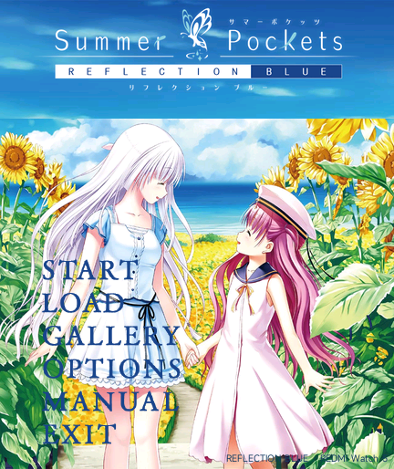
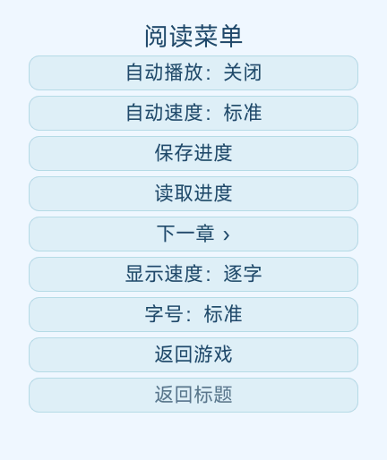

# 0.2.0 界面与自动阅读

由 Codex 在维护者指导下完成。此为本地候选版，未自动发布到 GitHub。

- 标题按钮使用原作素材，背景透明，统一左对齐，较上一稿右移 18 px。双人插画扩大取景，Logo 位于独立天空区域。
- 根据原作剧情流与程序中的通关计数，提供 ReSTART、ALKA、Pocket 的阶段入口。独立保存全局通关标记；旧存档键和剧情指令位置不变。
- 自动播放默认关闭，速度档位单独保存。自动模式 30 ms/字，结束后慢速等 2.6 秒、标准 1.5 秒、快速 0.8 秒；超过 60 字的部分增加 55 ms/字，额外不超过 5 秒。
- 选项须自行选择，选完自动继续。菜单、存读档、触摸滚动正文和切到后台期间暂停，返回重新计时。手动补全文字后重新等待；上一句、返回标题、结束、错误会关闭自动。
- 已有立绘、CG、背景不降画质。PNG 保留尺寸、颜色类型和每个 RGBA 样本；JPEG 文件不重新编码。新标题按手表画幅裁剪和缩放。
- 新增 BGM32 完整 237 秒目录曲，11.025 kHz 单声道 IMA ADPCM WAV，为包体限制对音频降采样；不宣称音频无损。WAV 保留两秒静音尾段，定时在 EOF 前停止并释放，1.2 秒后重播。菜单 OPTIONS 可关闭音乐。
- 安装包使用 PNG、WAV STORE，原有文本以更小的 DEFLATE 储存；签名与 r1 打包兼容流程保留。保持 25,000,000 字节上限。

若新版出现卡住、异常退出或重启，先退出应用并在 OPTIONS 关闭标题音乐再试；无法操作时重启手表，保留存档后用旧版 0.1.7 覆盖回退。卸载可能清除存档，不要反复开关机或连续重装。记录设备固件、包版本、操作步骤和故障画面，便于复现。模拟器通过不能保证所有实机固件都没有问题。

构建直接使用已收录的无损压缩缓存，无需在每次编译时运行耗时的 PNG/Zopfli 优化。需要重生成缓存时，Python 安装 Pillow、zopfli 0.4.3；设置 WATCH_COMPRESSION_DEPS 可使用独立依赖目录。prepare-title-audio.py 需要 SUMMER_GAME_ROOT、WATCH_FFMPEG；build-original-ui.py 需要从原版提取的 atlas、Logo 和维护者的原图，不会下载或运行原游戏程序。

