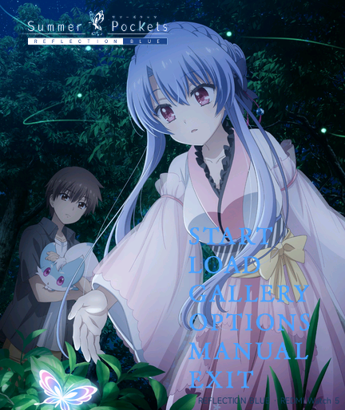

# 0.2.1 标题界面调整

按维护者提供的参考图更换背景。使用动画官网 Visual Gallery 的「メインビジュアル（空門蒼編）」1414×2000 原图，不从唱片封面抠图。

原图：https://summerpockets-anime.jp/wp_summer/wp-content/uploads/2025/07/20250709145630.jpg
来源页面：https://summerpockets-anime.jp/visualgallery/
版权：©VISUAL ARTS/Key/鳥白島観光協会。图片不属于项目代码的 MIT 许可。

背景按 432×514 画幅等比裁剪，去除唱片边框和文字；按钮透明、统一左对齐，对齐线位于 x=232 px（屏幕约54%），整体放在中间偏右区域。原作 Logo 缩小放于左上方，避开人物面部。保留 ReSTART、ALKA、Pocket 的出现条件、30 栏存档、自动阅读和目录曲。

本次只更改标题图片、按钮配色与布局，音频、剧情、存档和通关逻辑保持 0.2.0 的实现。安装包继续限制在25,000,000字节以内。尚需本版实机确认；模拟器检查不能保证全部固件表现相同。

重建当前背景：`python tools/build-title-v021.py --source <已下载的官方原图>`。缺省时脚本从上述官方地址获取图片，并校验 SHA256；原图不打包进手表应用。

38 项现有检查通过，官方原生模拟器全新安装成功；读回的标题图片与源文件一致，移动后的 LOAD 按钮和第30栏虚拟存档加载已检查。模拟器覆盖安装返回 -19，原因尚未确定；测试时先备份虚拟存档再全新安装，不能据此保证真实手表覆盖更新成功。真实设备请先保留旧安装包和存档，不要为了尝试更新而直接卸载。

