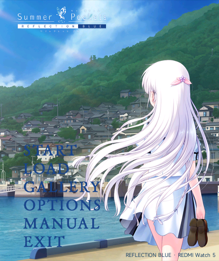

# 0.2.2 标题背景与左侧按钮

使用维护者此次提供的港口图片裁剪，去掉上下黑边，保留右侧白羽与港口景色。原图为2551×1587；有效画面纵向范围为80～1520，按432×514屏幕比例裁剪。

透明原作按键回到左侧竖向排列，统一左对齐，左对齐线位于x=42px。使用原作深蓝色按键字样以适应明亮背景。Logo继续放在左上方，避开右侧人物。

本次仅调整标题背景、按钮素材配色和标题布局。剧情、30栏存档、通关入口条件、自动阅读和目录曲文件及逻辑不变。原作图像不属于代码的MIT许可。新版仍需实机确认；之前模拟器覆盖安装曾返回-19，原因未定，请保留旧包和存档，不要直接卸载真实设备上的旧版。

背景可用 `python tools/build-title-v022.py <此次上传的原图路径>` 重建；原图不包含在安装包中。

本次构建校验全部1966项媒体/剧情资源与源文件一致，ZIP CRC通过；11项页面/通关回归检查通过。原生模拟器使用本次构建的页面与标题资源核对显示，并确认左侧LOAD按钮可打开30栏存档列表；未重复完整安装或实机测试。

