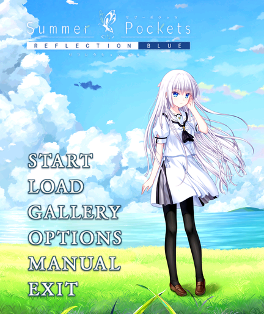

# 夏日口袋 0.2.4：标题界面调整

安装文件 `summer-rw5-v0.2.4.bin` 与同版本 RPK 内容相同，均为 **24,984,817 字节**，低于 25,000,000 字节。versionCode 为 13，包名和存档键保持不变。

SHA256：`453bdc986b9c26261b45c473b6e384e6c01907e85c9ba32d48b1af40d6729dcc`。

- 标题 Logo 从 210×60 放大到 **320×92**，继续使用原作 Logo。
- 白羽改用**原作标题插画中抬手扶发的形象**，替换拿西瓜的剧情立绘。直接从 `OTHCG.PAK/__SYS_TM_BGRB01B` 取原作人物像素，与同机位原作干净背景 `__SYS_TM_BGRB04e` 的 RGB 合成后裁剪到手表画幅；没有重新绘制人物。
- 去掉右下角 `REFLECTION BLUE · REDMI Watch 5` 小字。
- 按键保持 A 配色、透明背景和左对齐，行距从 **36 增至 42**。已核对普通六键、ReSTART 阶段及通关后八键布局，避免覆盖白羽面部和标题 Logo。

本次仅调整标题。剧情、全部 CG、游戏内立绘、字体、目录曲文件以及播放控制模块均与 0.2.3 一致，没有进一步压缩画质。通关入口、自动阅读、30 栏存档及其格式保持不变。

11 项页面/通关回归检查通过；最终 RPK 的 CRC、资源差异白名单及已验证媒体字节一致性检查通过。独立官方 Vela 模拟器已显示本次构建的页面和标题，放大的 Logo、白羽姿势、按键间距及小字移除已核对；移动后的 LOAD 按键可打开 30 栏存档列表。已读回模拟器中的页面和标题文件，确认与最终包对应文件一致。

此次原生检查是在已有独立虚拟安装中替换页面及标题资源后重启预览；**没有重复完整安装 0.2.4 RPK，模拟器安装管理器的版本记录仍为 0.2.3，也没有新的实机测试**。0.2.3 的音频连续循环和正常退出后的另一应用播放记录继续保留，但不代表已覆盖所有实机或并行应用切换情形。

安装时任选 BIN 或 RPK。工具提示完成后，请等待手表端真正完成安装再打开。更新前保留旧包和存档，不要为解决覆盖安装失败而直接卸载有存档的版本。原有音频取舍（完整曲目、PCM 16 位 / 4 kHz 单声道）和异常处理方法见项目内 `docs/v0.2.3.md`；屏幕无响应时，REDMI Watch 5 官方 FAQ 指示长按电源键约 18 秒，直到 REDMI 标志出现再松开：[官方说明](https://www.mi.com/pk/support/faq/details/KA-521474/)。

源码与资源仍分成两个小于 25 MB 的 ZIP，开发时解压到同一目录共同组成项目；安装游戏只需要 BIN 或 RPK。标题可用 `tools/build-title-v024.py` 从原版资源重建。原作素材不属于自编代码的 MIT 许可范围。
