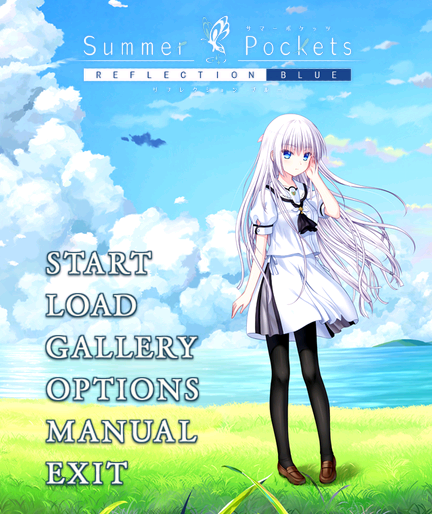

# 夏日口袋 0.2.5：顶部居中 Logo 与鉴赏音乐

安装包 `summer-rw5-v0.2.5.bin` 与同版本 RPK 内容相同，为 **24,983,953 字节**，低于 25,000,000 字节；versionCode 为 14，包名和存档键不变。

SHA256：`cee59ba0733f578d177b19e64eb27f867b41817cca1682e8baa64ef4f3d2db44`。

标题 Logo 保持 320×92，在 432 像素屏幕上移至 **x=56、y=8**，顶部水平居中。白羽标题插画、A 配色、42 像素按键行距及已去除的右下角小字保持 0.2.4 的设置。

## 目录曲播放范围

- 标题、OPTIONS、MANUAL、LOAD 栏位列表、CG 列表和单张 CG 鉴赏共用当前播放，互相切换、翻页、切换差分时保持进度，不从头起播。
- 从剧情菜单打开读取栏位时，也会播放目录曲；取消返回剧情菜单，或读档成功进入剧情时停止。
- 保存栏位、路线/章节阅读、错误页面、后台及退出仍会停止音乐。关闭标题音乐的设置在上述所有界面生效。
- 保留原来的单播放流、静音尾段内停止并重建的循环方式；仍然不使用原生 loop、不轮询播放器属性，也不修改系统音量。

目录曲文件和底层播放控制模块没有改变：仍为完整 237 秒曲目、PCM 16 位 / 4 kHz 单声道，附加 2 秒静音尾段。全部图像、剧情、字体及音频文件与 0.2.4 逐字节一致。本次改变的是页面允许播放的范围和导航时的清理逻辑。

## 验证

47 项自动检查全部通过，新增覆盖跨界面不断流、首次播放延迟内快速切换、CG 内循环、剧情内 LOAD、读档后停止、关闭音乐、后台及错误清理。

独立官方 Vela 模拟器中，标题、LOAD、返回标题、CG 列表、CG 差分、返回列表再打开 CG 的音频进度依次为 142.848、145.920、147.968、151.040、153.088、153.088、155.648 秒，播放流版本号保持一致。随后在 CG 界面完成整曲停止与重播，加载旧第 30 栏存档（7:43）后音乐停止，返回标题后重新播放。Logo 居中已核对。

本次原生检查将最终编译页面放入停止后的独立虚拟安装再重启，**没有重复完整安装 0.2.5 RPK，模拟器安装管理器的版本记录仍为 0.2.3**。编译页面读回与最终包匹配；最终包的 CRC 和全部资源/编译文件一致性检查通过。维护者随后于 **2026-10-26** 反馈“实测通过”，确认 0.2.5 已通过 REDMI Watch 5 实机测试；见 [实机反馈记录](../reports/hardware-test-v025.json)。未提供固件版本及逐项测试清单，不据此保证所有固件或并行应用切换场景。

## 安装和文件

安装时任选 BIN 或 RPK。安装工具提示完成后，等待手表端真正安装结束再打开；更新前保留旧包和存档，避免直接卸载已有存档的版本。源码与转换资源分别提供两个 ZIP，开发时解压到同一目录；安装游戏不需要这两个 ZIP。

若音频异常，可在 OPTIONS 关闭标题音乐后退出游戏，再重新进入开启。其他应用仍无声时，先完整退出本游戏，再重新打开原应用；必要时使用手表系统菜单重启。屏幕完全无响应时，REDMI Watch 5 官方 FAQ 给出的操作是长按电源键约 18 秒，直到 REDMI 标志出现再松开：[官方说明](https://www.mi.com/pk/support/faq/details/KA-521474/)。

正式发布地址：[GitHub v0.2.5](https://github.com/xuanyide01/summer-rw5/releases/tag/v0.2.5)。原作素材和第三方字体不属于自编代码的 MIT 授权范围。
