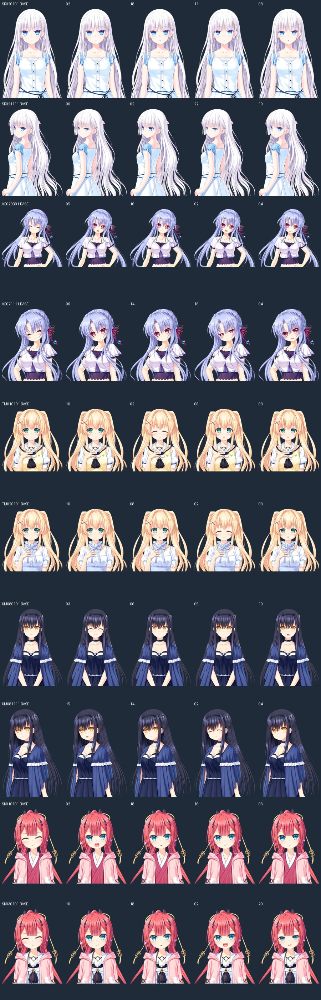

# 夏日口袋 0.3.0 · 五女主与表情差分

目标 REDMI Watch 5。维护者于 2026-10-27 确认重置手表后安装运行成功，目前暂未发现游戏内 bug；首次安装问题尚未定位。安装文件与 RPK 相同，为 **24,983,777 字节（约 24.984 MB）**，versionCode 15，包名不变。

SHA256：`964e1db4693560fa5fefdb5a1a162bb8f344fd7d0003edd05d58249eba325916`。

## 实机安装反馈（2026-10-27）

维护者于 **2026-10-27** 反馈：首次安装后无法显示应用图标，重启手表后仍未安装成功；重置手表后安装成功，随后暂未发现游戏内 bug。**首次安装兼容性问题尚未定位；本次确认的是重置后的安装与运行情况。重置并非推荐安装步骤。**

未提供固件版本、安装错误码或完整测试清单；不能将此记录等同于所有设备直接安装均已通过。见 [原始反馈记录](../reports/hardware-test-v030.json)。

## 画面点击与章节标签

- 去掉阅读对话框顶部蓝色描边。
- 上方整块画面增加独立点击区域，点击 CG、背景和人物都能补全当前句或推进下一句；拖动不会误翻句。逐字显示未完成时，第一次点击补全，下一次推进。
- 避免重复赋值未改变的图片路径，减少不必要的画面更新。
- 共通线包括角色的共通事件，只显示实际日期，例如“7月26日”；进入个人线后仅显示人物名，不显示 `0000` 等内部编号。存档摘要采用相同规则。

## 保留内容和解锁

个人线保留 **鸣濑白羽、空门苍、紬文德斯、久岛鸥、神山识** 五位。按维护者确认，**ALKA、Pocket 和尾声保留**。

美希、静久、羽未的个人线移除；她们在共通线中的事件仍可阅读。移除 67 个个人场景的正文和分支入口，保留场景编号与其余指令地址；章节入口由 315 减为 252，保留 81,040 条对白/旁白和 188 处对白选择。

为避免最终篇被已移除线路锁住，ReSTART 改为完成第 4、第 5 条个人线后的对应阶段；完成五条后解锁 ALKA，ALKA 完成后解锁 Pocket。不会伪造美希或静久的通关标记。

30 个存档键、保存格式和已有全局进度格式不变。**已移除个人线内的旧存档无法在此精简版继续**，会显示提示；请保留 0.2.5 用于读取这些存档。其余保留场景的旧档继续可读，不会自动覆盖旧栏位。卸载可能清除存档。

## 新增表情与资源

- 新增 **40 个表情差分**，五位女主各 8 个，覆盖各自两种常用姿势。
- 从原作同镜头完整立绘与眼睛、嘴巴补丁按原画布坐标合成，再按已有裁剪与尺寸输出。仍然只显示一张完整人物图，不把局部补丁当作整个人物，也不增加多层立绘。
- 保持已有 200×256 尺寸上限及 RGBA 质量；新增 PNG 无损重压缩节省 197,598 字节，逐像素检查一致。新增表情单张最大解码量仍为 203,200 字节。
- 对应移除不再使用的图片约 1.57 MB；CG 从 856 张/155 组精简为 **712 张/136 组**，保留剧情实际引用的 CG 及其场景差分。
- 二进制图片、PCM 音频、字体仍使用 STORE 封装。DEFLATE 条目由 441 减为 367，涉及的解压数据由 11,495,706 减为 9,713,673 字节；最大条目由 326,900 减为 324,644 字节。此为封装统计，未测量真实固件峰值内存。

## 验证

52 项自动检查通过，覆盖现有存档、字幕、音频、CG、分块、章节跳转及本次改动。另从五条保留线路通关状态完整遍历 ALKA、Pocket，分别到达原最终篇结局，未补记被移除角色的通关。

最终完整 RPK 在独立官方 Vela 虚拟手表全新安装成功，安装后版本为 0.3.0 / 15，读回编译页面与最终包一致。模拟器覆盖安装尝试返回 -19，原因未确认；备份虚拟存档后全新安装成功，不据此建议在真实手表直接卸载更新。

原生界面检查中，上方画面推进 23 次成功，本次最大响应时间 161 毫秒；共通事件日期、个人线姓名、代表表情切换显示正确；旧第 30 栏存档加载到 7:43；返回标题目录曲正常播放。测试后虚拟存档按字节恢复。实机反馈随后确认重置后安装成功、暂未发现游戏内 bug；首次及重启后安装失败的原因仍未确认。

## 安装与异常处理

使用“表盘自定义工具”等兼容工具安装 BIN 或 RPK。工具显示完成后仍需等待手表端安装结束，不要反复安装。更新前保留旧包与存档，尤其是此次移除线路内的旧档。

应用无响应但系统可操作时，退出后重新进入并读取最近手动存档；音频异常可在 OPTIONS 关闭音乐并完整退出再重开。整个 REDMI Watch 5 无响应时，按 [官方 FAQ](https://www.mi.com/pk/support/faq/details/KA-521474/) 长按电源键约 18 秒，直到 REDMI 标志出现后松开。

正式发布地址：[GitHub v0.3.0](https://github.com/xuanyide01/summer-rw5/releases/tag/v0.3.0)。程序由 OpenAI Codex 在维护者需求与反馈指导下完成。自编代码采用 MIT；原作素材与第三方素材不在该代码许可范围内。
